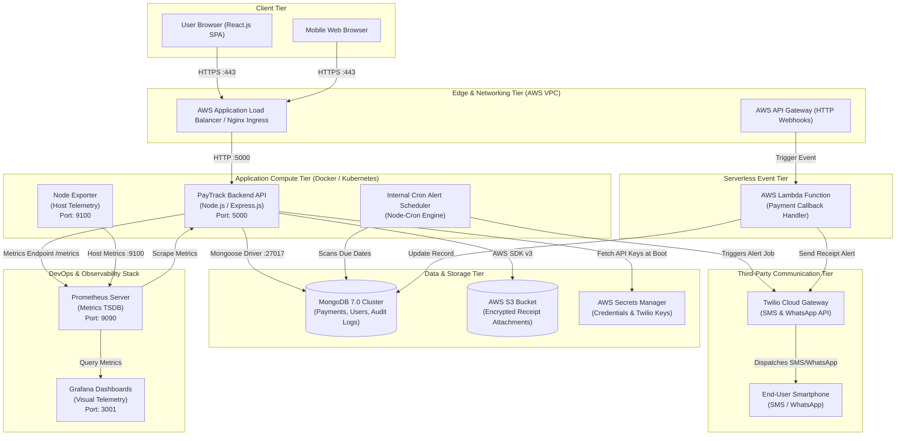
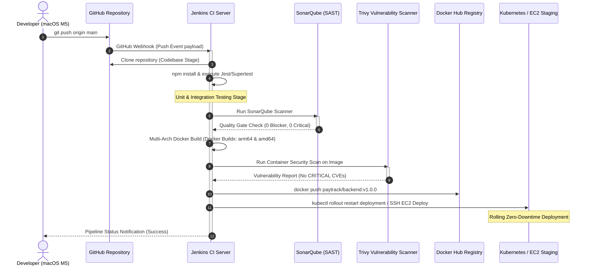
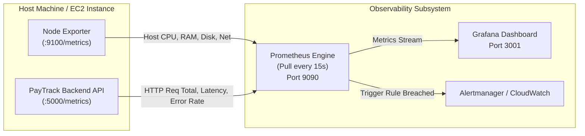

# PayTrack 2.0 – System Architecture & Engineering Design

> **Course:** INT378 – Advancements in Cloud and DevOps (2026–27)  
> **Institution:** Lovely Professional University (LPU)  
> **Document Type:** Comprehensive Architectural Blueprint  
> **Status:** Baseline Approved (Milestone 1)  

---

## 1. High-Level Architectural Overview

PayTrack 2.0 is designed as a **cloud-native, modular, containerized multi-tier web application** with an event-driven notification engine and serverless extension. It implements the **Twelve-Factor App methodology**, strict separation of concerns, zero-trust security principles, and continuous observability.

The architecture comprises six primary layers:
1. **Client / Presentation Layer:** React.js Single Page Application (SPA).
2. **API Gateway & Ingress Layer:** Application Load Balancer (ALB) / Nginx Ingress Controller.
3. **Application & Processing Layer:** Node.js/Express.js microservices with Prometheus telemetry.
4. **Data & Storage Layer:** MongoDB (Document Store) and AWS S3 (Receipt Objects).
5. **Serverless & Notification Layer:** AWS Lambda, AWS API Gateway, and Twilio REST API.
6. **DevOps & Observability Layer:** Jenkins, SonarQube, Trivy, Prometheus, Node Exporter, and Grafana.

---

## 2. System Architecture Diagrams

### 2.1 End-to-End System Component Architecture



---

### 2.2 AWS Cloud Infrastructure & VPC Topology

The infrastructure is provisioned through **Terraform** and **AWS CloudFormation** to ensure full IaC reproducibility across AWS Availability Zones.

```mermaid
flowchart TB
    subgraph AWSCloud["AWS Cloud (Region: ap-south-1 / us-east-1)"]
        IGW["Internet Gateway (IGW)"]

        subgraph VPC["Custom VPC: 10.0.0.0/16"]
            
            subgraph PublicSubnets["Public Subnets (10.0.1.0/24 & 10.0.2.0/24)"]
                ALB_AWS["Application Load Balancer (ALB)"]
                NAT_GW["NAT Gateway (Elastic IP)"]
                Bastion["Bastion / Jump Host (Optional SSH)"]
            end

            subgraph PrivateAppSubnets["Private Application Subnets (10.0.10.0/24 & 10.0.11.0/24)"]
                direction TB
                EC2_App1["EC2 Instance A (Ubuntu 22.04)\nDocker / K8s Worker\nPayTrack Backend + Frontend"]
                EC2_App2["EC2 Instance B (Ubuntu 22.04)\nDocker / K8s Worker\nReplica / Failover"]
                Prom_EC2["Prometheus & Node Exporter"]
            end

            subgraph PrivateDataSubnets["Private Database Subnets (10.0.20.0/24 & 10.0.21.0/24)"]
                DB_Primary[("MongoDB Primary / Replica")]
            end

        end

        subgraph AWSServices["Managed AWS Services"]
            S3["Amazon S3\n(Receipt Assets)"]
            SecMgr["AWS Secrets Manager"]
            CW["Amazon CloudWatch\n(Logs & Alarms)"]
            Budgets["AWS Budgets\n($5 / $10 Thresholds)"]
            LambdaFn["AWS Lambda Function"]
        end
    end

    IGW <--> PublicSubnets
    ALB_AWS -->|Forward Traffic (Port 5000)| PrivateAppSubnets
    NAT_GW -->|Outbound Internet Access| PrivateAppSubnets
    PrivateAppSubnets -->|Store / Fetch Receipts| S3
    PrivateAppSubnets -->|Read Secrets| SecMgr
    PrivateAppSubnets -->|Push Logs & Metrics| CW
    PrivateAppSubnets --> DB_Primary
```

---

### 2.3 End-to-End DevSecOps CI/CD Pipeline

The Continuous Integration, Security Scanning, and Deployment pipeline is fully automated via **Jenkins**, triggered via **GitHub Webhooks**.



---

### 2.4 Real-Time Metrics & Observability Flow



---

## 3. Detailed Component Breakdown

### 3.1 Presentation Tier (`frontend/`)
- **Technology:** React.js 18 with modern React Hooks (`useState`, `useEffect`, `useContext`).
- **Routing:** React Router v6 for client-side protected route guardrails.
- **State Management:** Context API for global authentication state, token storage, and user role claims.
- **Styling:** Responsive, modern dashboard UI designed with Tailwind CSS.
- **Containerization:** Multi-stage Docker build utilizing an Nginx Alpine base image for serving static production assets with minimal memory footprint (< 25MB).

### 3.2 Application Tier (`backend/`)
- **Technology:** Node.js 20 LTS with Express.js web framework.
- **Security & Hardening:**
  - `helmet`: Automatically sets secure HTTP headers (XSS filter, frameguard, HSTS).
  - `cors`: Configured to only permit authorized client origins.
  - `express-rate-limit`: Prevents brute-force credential attacks on `/api/auth/*`.
  - `bcrypt`: Industry-standard password hashing with cryptographic salt work factor of 10.
  - `jsonwebtoken (JWT)`: Stateless token generation for authentication and role authorization.
- **Telemetry:** `prom-client` integrated into Express middleware to instrument every inbound HTTP request.

### 3.3 Data & Storage Tier
- **MongoDB 7.0:** Document-oriented database enforcing schema validation via Mongoose ODM.
  - `users`: User identity, hashed passwords, phone numbers, alert preferences, and roles (`ADMIN`, `MANAGER`, `USER`).
  - `payments`: Title, amount, category, currency, due date, status (`PENDING`, `PAID`, `OVERDUE`), recurring frequency, receipt URL, and user reference ID.
  - `notifications`: Audit trail of all dispatched alerts, message delivery status, recipient numbers, and Twilio message SIDs.
- **AWS S3 (Receipt Storage):**
  - Private S3 Bucket with Server-Side Encryption (SSE-S3 / AES-256).
  - Receipts retrieved via short-lived AWS IAM pre-signed URLs.

### 3.4 Smart Notification Engine (`backend/services/notificationService.js`)
- **Twilio REST API:** Dispatches SMS messages and WhatsApp messages through Twilio's programmable messaging endpoint.
- **Scheduler:** Automated background cron job running on Node.js process evaluating pending payments against the current system time to trigger proactive alerts.

### 3.5 Infrastructure as Code (IaC) Tier (`infrastructure/`)
- **Terraform (`infrastructure/terraform/`):**
  - Fully modularized infrastructure: VPC, Public/Private Subnets, Internet Gateway, Route Tables, NAT Gateway, Security Groups, EC2 compute instances, and S3 storage bucket.
- **AWS CloudFormation (`infrastructure/cloudformation/`):**
  - Native AWS YAML template providing an alternative declarative deployment mechanism for EC2, VPC, IAM roles, and CloudWatch alert alarms.

### 3.6 Container & Orchestration Tier (`infrastructure/kubernetes/`)
- **Docker Multi-Stage Builds:** Minimizes image size by compiling code in a build container and copying only production artifacts into a hardened, non-root base image.
- **Kubernetes Manifests:**
  - `Deployment`: Manages pod replicas, rolling updates, and readiness/liveness health probes.
  - `Service`: Exposes pods via `ClusterIP` for internal traffic and `NodePort` / `LoadBalancer` for external ingress.
  - `ConfigMap` & `Secret`: Decouples runtime configuration and encrypted credentials from container images.
  - `HorizontalPodAutoscaler (HPA)`: Dynamically scales pods from 2 to 10 instances based on CPU utilization.

---

## 4. Security Architecture & Threat Modeling

1. **Principle of Least Privilege (PoLP):** AWS IAM roles attach only the exact permissions needed (e.g., S3 PutObject/GetObject for receipts; zero broad admin rights on EC2 instances).
2. **Network Isolation:** Database and application tiers reside in private subnets with no public IPv4 addresses; inbound access is only permitted from the ALB Security Group.
3. **Static Application Security Testing (SAST):** SonarQube analyzes every commit during CI for code smells, OWASP Top 10 vulnerabilities, and security hotspots.
4. **Container Image Hardening:** Trivy scans container layers for known CVEs. Images execute with a non-root user (`USER node`).
5. **Secrets Hygiene:** `.env` files are excluded from Git via `.gitignore`. In AWS environments, credentials are dynamically retrieved from AWS Secrets Manager.

---

## 5. Cost Optimization & Cloud Governance Strategy

To ensure zero budget overruns during academic evaluation:
- **AWS Free Tier Compute:** Default instances configured as `t2.micro` or `t3.micro` (1 vCPU, 1 GiB RAM).
- **Storage Optimization:** EBS volumes provisioned as General Purpose SSD (`gp3`) with minimal 8 GiB capacity.
- **Log Retention:** CloudWatch Log Groups configured with an explicit 7-day expiration policy to prevent unbounded log storage costs.
- **AWS Budgets & Cost Explorer:** Automated budget set at \$5.00 with SNS email alerts triggered when actual spend reaches 80% (\$4.00) and forecasted spend reaches 100%.
